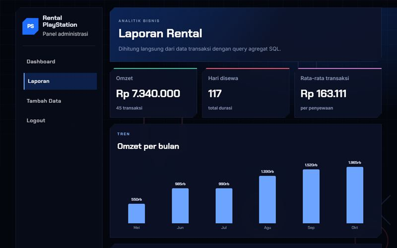

# Rental PlayStation

Aplikasi admin PHP dan MySQL dengan laporan omzet.

**Demo:** https://portofolio-jauza-fawaid.netlify.app/RENTAL-PLAYSTATION/ (pratinjau statis dengan data contoh)



Aplikasi admin untuk mencatat penyewaan PlayStation, dengan laporan analitik dari query agregat SQL.

## Fitur

- Login dengan kata sandi ter-hash, pergantian ID sesi, dan pembatasan percobaan
- CRUD penyewaan dengan validasi di server
- Laporan omzet per bulan, kinerja per jenis, dan penyewa teratas
- Pencarian tabel langsung dan ekspor CSV

## Keamanan

- Prepared statement pada semua query dengan masukan pengguna
- Token CSRF pada semua form, dan penghapusan hanya lewat POST
- Keluaran di-escape dengan `htmlspecialchars`
- Pengaturan koneksi lewat variabel lingkungan `DB_HOST`, `DB_PORT`, `DB_NAME`, `DB_USER`, `DB_PASS`

## Menjalankan

1. Impor `database.sql` lewat phpMyAdmin. Berkas ini membuat database `rental_playstation`.
2. Letakkan folder di `htdocs` dan buka `login.php`.
3. Akun demo ada di komentar `database.sql`. Data penyewaan di dalamnya fiktif.

## Pengujian

Jalankan server, lalu:

```bash
node tests/e2e.mjs http://localhost/RENTAL-PLAYSTATION
```

## Teknologi

PHP, MySQL, JavaScript
